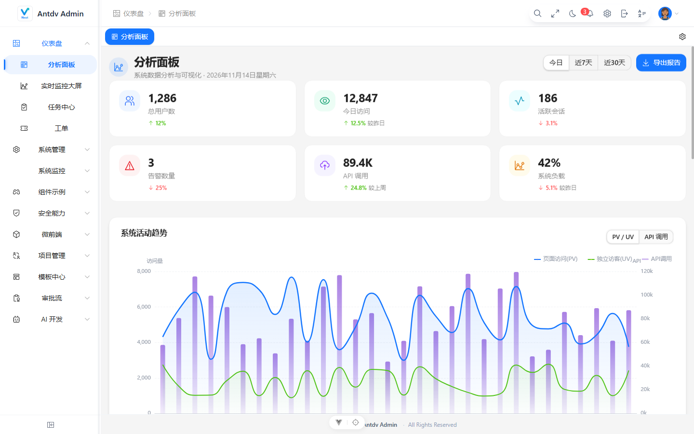
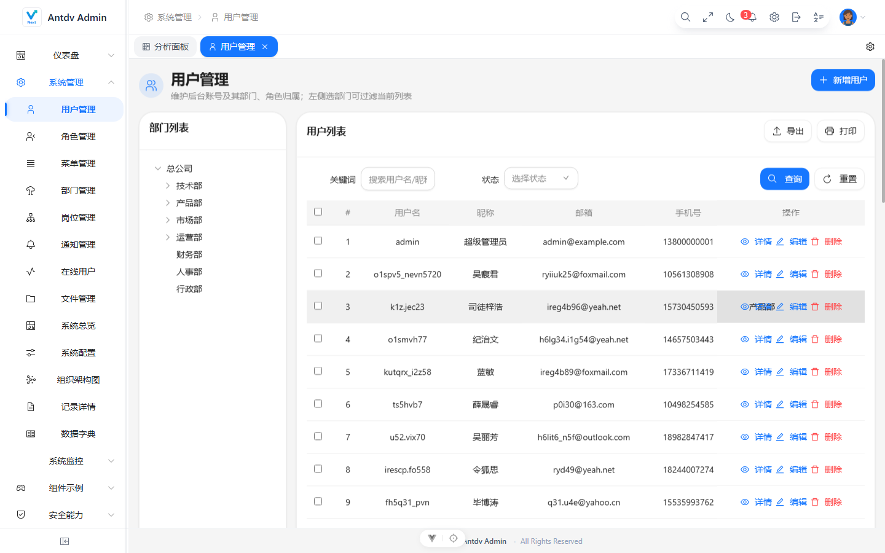
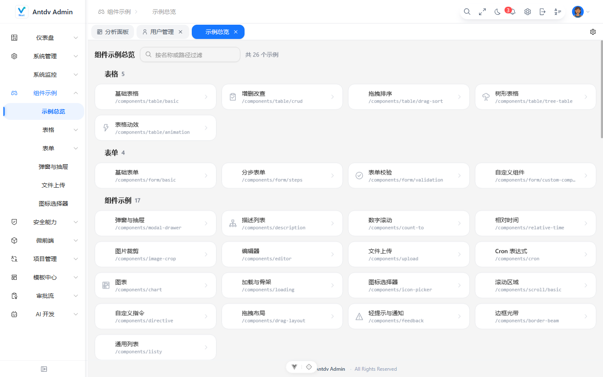
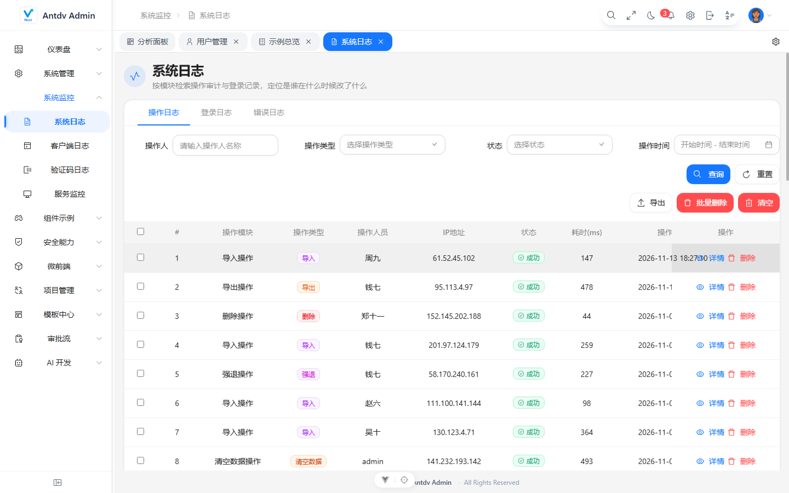
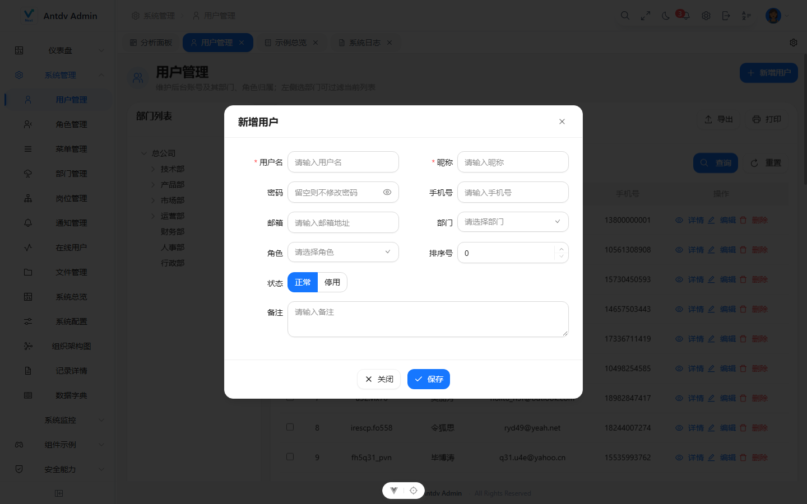

# Antdv Next Vue Admin

[English](./README.en.md) | **简体中文**

现代化企业级后台管理系统模板：Vue 3 + TypeScript + reka-ui / shadcn-vue + Tailwind CSS v4，pnpm Monorepo。开发期零后端即可跑通（进程内 Nitro Mock），并带 chromium / firefox / webkit 三引擎端到端测试。

---

## 技术栈

| 类别   | 技术               | 版本         |
| ------ | ------------------ | ------------ |
| 框架   | Vue 3 + TypeScript | 3.5.43 / 6.0 |
| UI     | reka-ui + shadcn   | 2.11.0       |
| 样式   | Tailwind CSS v4    | ^4.3.3       |
| 状态   | Pinia 3            | ^3.0.4       |
| 路由   | Vue Router         | ^5.3.1       |
| HTTP   | 自研 fetch 请求层  | —            |
| i18n   | vue-i18n           | ^11.4.13     |
| 图表   | ECharts            | ^6.1.0       |
| 构建   | Vite               | ^8.3.3       |
| Mock   | Nitro（进程内）    | ^2.13.4      |
| 包管理 | pnpm               | 10.12.4      |

版本一律来自根 `pnpm-workspace.yaml` 的 catalog，子包写 `"xxx": "catalog:"`，所以这张表就是真实版本。

---

## 快速开始

```bash
pnpm install          # preinstall 强制 pnpm，npm/yarn 会被拦下
pnpm dev              # 管理后台 http://localhost:6080
```

登录账号（mock）：`admin` / `admin123`。

Mock 服务由 dev 进程**在进程内**拉起（Nitro，端口 5320），`/api` 由 dev server 代理过去，所以不需要先起后端。要求 Node `>=22`。

---

## 安全能力

模板内建安全中心（安全总览 / 审计日志 / 脱敏策略 / AI 安全策略 / AI 调用审计）：全链路五元组审计、策略驱动的服务端脱敏、菜单与按钮两级权限、AI 提示词注入检测与输出审核、调用限流与风险分级。设计边界、合规对照与扩展点见 [SECURITY.md](./SECURITY.md)。

---

## 界面预览

> 以下截图均取自本地 dev 环境（`admin` / `admin123`），浅色主题、1440×900。

### 分析面板

数据总览 + ECharts 趋势图，所有配色走 design token，切换主题预设自动跟随。



### 系统管理

左侧部门树 + 右侧数据表格，表格统一带操作栏；新增 / 编辑走弹窗表单，详情走抽屉。



<details>
<summary>展开更多页面截图</summary>

**组件示例**



**系统日志（操作日志 / 登录日志 / 错误日志 合并为标签页）**



**弹窗表单（完整字段 + 常驻底部按钮）**



</details>

---

## 仓库结构

```
apps/
├── web/                  # 管理后台（@antdv/web）
│   ├── src/
│   │   ├── api/          # 接口封装（request.ts 提供 get/post/put/del）
│   │   ├── composables/  # 应用内组合式函数（re-export @antdv/request）
│   │   ├── config/       # constants（缓存键名、登录路径等）
│   │   ├── layouts/      # 应用侧布局装配（外壳来自 @antdv/layouts）
│   │   ├── locales/      # zh-CN / en-US
│   │   ├── plugins/      # 运行时注入（请求层凭证、vue-query、表格、UI 外壳）
│   │   ├── router/       # 文件约定路由 + 守卫注册（守卫来自 @antdv/router）
│   │   ├── stores/       # user / app / route / dict / tabs
│   │   ├── utils/        # ws.ts 单例、cache、crypto、安全初始化
│   │   └── views/        # 页面：login system dashboard screen components ...
│   └── e2e/              # Playwright 端到端（三引擎）
├── backend-mock/         # Nitro mock 接口与运行时控制
docs/                     # VitePress 文档站，与 apps/ 齐平的独立包，不参与应用构建
packages/                 # 运行时子包（core/{base,ui-kit,composables,preferences} / request / layouts / router / enums / utils / directives ...）
internal/                 # 构建与规范工具（vite-config / lint-configs / tsconfig / node-utils）
scripts/                  # vsh 等仓库任务
.changeset/               # 版本与变更说明
.github/workflows/        # ci.yml（门禁）+ docs.yml
```

> **关键约束**：`packages/*` 之间**不许** import `pinia` / `vue-router` / store，需要的能力靠依赖注入拿，这样它们才能在别的项目里单点复用；子包对外被消费的是 **`dist` 产物**，改完 `packages/*/src` 记得 `pnpm --filter <pkg> build` 并重启 dev。

---

## 开发脚本

```bash
pnpm build            # 全量构建（turbo）
pnpm lint             # eslint（vsh lint）
pnpm check            # 循环依赖 + 依赖方向 + 类型检查 + 拼写
pnpm test:unit        # vitest，按 turbo 任务图先构建依赖
pnpm test:e2e         # Playwright，chromium / firefox / webkit
pnpm check:type       # vue-tsc（有存量类型债务，报告但不拦截）
pnpm changeset        # 记录变更说明
```

CI（`.github/workflows/ci.yml`）分三个 job：`quality`（lint + 循环依赖 + 单测，拦截）、`e2e`（三引擎矩阵，拦截）、`type-check`（存量债务，报告但不拦截）。

---

## 贡献指南

- 提交信息遵循 Angular 提交规范（Conventional Commits），可用 `pnpm commit` 交互式生成；
- 提交前确保 `pnpm lint`、`pnpm test:unit` 通过；
- 影响发布产物的改动请补一条 changeset（`pnpm changeset`）。

---

## License

MIT，见 `LICENSE`。
